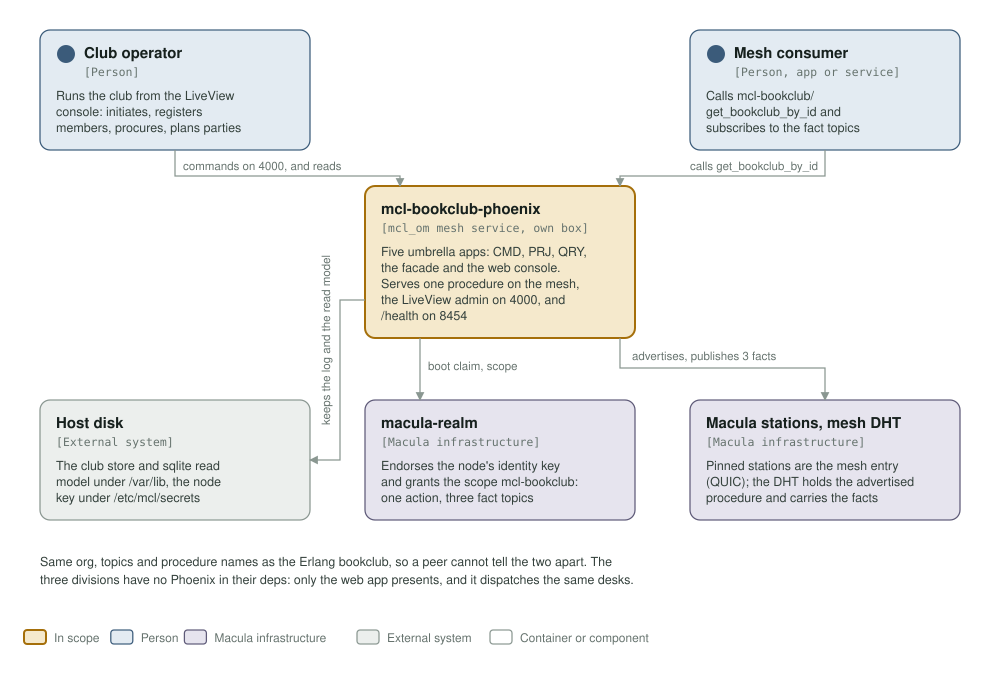
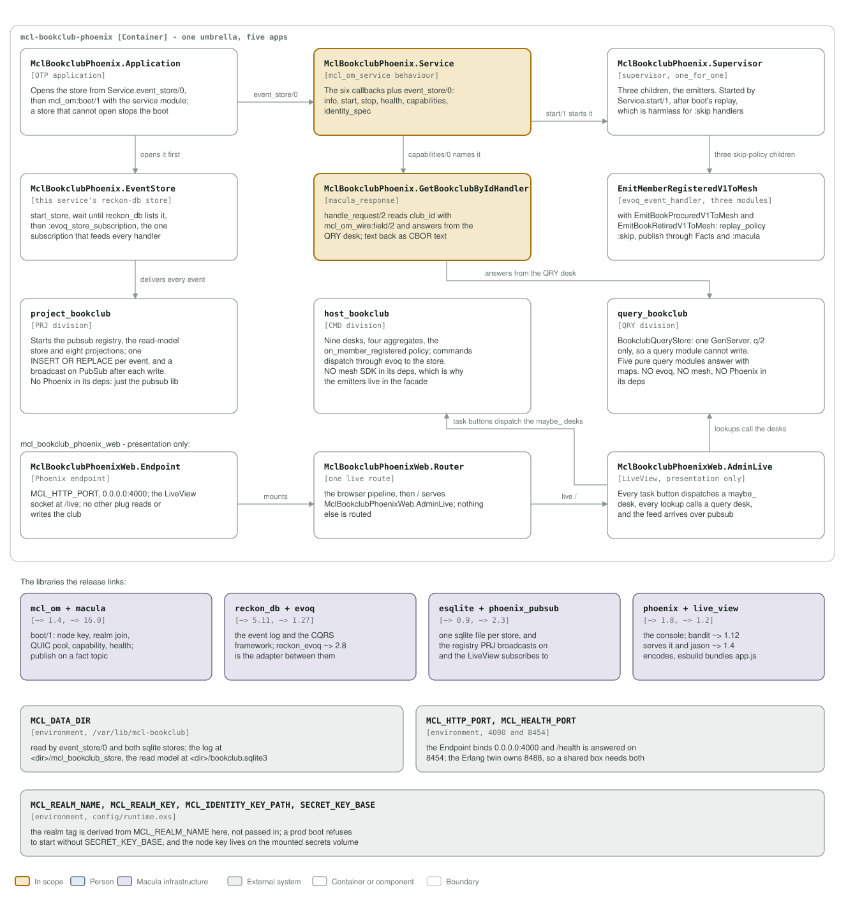

# mcl-bookclub-phoenix architecture: C4 model

*This exists so a reader can see what mcl-bookclub-phoenix talks to, and what it is
made of, without reading it.*

**Status: the full domain, plus the LiveView admin.** One umbrella of five apps: the
CMD, PRJ and QRY divisions, the facade that owns the mesh contract and the emitters,
and a Phoenix web app that presents the divisions through the same entry points the
mesh uses. One procedure is advertised, `mcl-bookclub/get_bookclub_by_id`; the
LiveView console runs on 4000; `/health` on 8454.

## Level 1: system context

| Element | Kind | Role |
| --- | --- | --- |
| mcl-bookclub-phoenix | In scope | Five apps in one release. Serves `mcl-bookclub/get_bookclub_by_id` on the mesh, the LiveView admin on 4000, and `/health` on 8454 |
| Club operator | Person | Runs the club from the LiveView console: initiates and archives clubs, registers and unregisters members, procures and retires books, starts and finishes readings, plans parties |
| Mesh consumer | Person | Another service or app on the mesh: calls the one advertised procedure and subscribes to the three fact topics |
| Host disk | External system | The club store and sqlite read model under `/var/lib/mcl-bookclub`, and the node identity key under `/etc/mcl/secrets` |
| macula-realm | Macula infrastructure | Endorses the node's identity key and grants the scope `mcl-bookclub`: one action and three fact topics |
| Macula stations, mesh DHT | Macula infrastructure | The pinned stations are the service's mesh entry points over QUIC; the DHT holds the advertised procedure and carries the fact topics |

Same org, topics and procedure names as the Erlang bookclub, so a peer cannot tell
the two apart. The three divisions have no Phoenix in their deps: only the web app
presents, and it dispatches the same desks the mesh and the tests use.

## Level 2: containers and components

| Component | Technology | Responsibility |
| --- | --- | --- |
| `MclBookclubPhoenix.Application` | OTP application | Opens the store from `Service.event_store/0`, then `mcl_om:boot/1` with the service module. A store that cannot open stops the boot |
| `MclBookclubPhoenix.Service` | the `:mcl_om_service` behaviour | `info/0`, `start/1`, `stop/1`, `health/0`, `capabilities/0`, `identity_spec/0`, plus `event_store/0`. `health/0` pings both sqlite store processes |
| `MclBookclubPhoenix.Supervisor` | supervisor, `one_for_one` | Three children, the emitters. Started by `Service.start/1`, after boot's catch-up replay, which is harmless for `:skip` handlers |
| `MclBookclubPhoenix.EventStore` | this service's reckon-db store wiring | `start_store`, wait until reckon_db lists it, then `:evoq_store_subscription`, the one subscription that feeds every handler |
| `MclBookclubPhoenix.GetBookclubByIdHandler` | `:macula_response` | `handle_request/2` reads `club_id` with `mcl_om_wire:field/2` and answers from the QRY desk; text goes back as CBOR text, booleans as 1/0 |
| `EmitMemberRegisteredV1ToMesh`, `EmitBookProcuredV1ToMesh`, `EmitBookRetiredV1ToMesh` | three `evoq_event_handler` modules | `replay_policy :skip`; each publishes through `MclBookclubPhoenix.Facts` and `:macula.publish` |
| `project_bookclub` | PRJ division | Starts the pubsub registry, the read-model store and eight projections. One `INSERT OR REPLACE` per event, and a broadcast on pubsub after each write. No Phoenix in its deps, only the pubsub library |
| `host_bookclub` | CMD division | Nine desks, four aggregates, and the `on_member_registered` policy. No mesh SDK in its deps, which is why the emitters live in the facade |
| `query_bookclub` | QRY division | `BookclubQueryStore`: one GenServer, `q/2` only, so a query module cannot write. Five pure query modules. No evoq, no mesh, no Phoenix |
| `MclBookclubPhoenixWeb.Endpoint` | Phoenix endpoint | `MCL_HTTP_PORT`, `0.0.0.0:4000`; the LiveView socket at `/live`; no other plug reads or writes the club |
| `MclBookclubPhoenixWeb.Router` | one live route | The browser pipeline, then `/` serves `AdminLive`. Nothing else is routed |
| `MclBookclubPhoenixWeb.AdminLive` | LiveView, presentation only | Every task button dispatches a `maybe_` desk, every lookup calls a query desk, and the feed arrives over pubsub |
| `mcl_om` + `macula` | libraries, `~> 1.4` and `~> 16.0` | `boot/1`: node key, realm join, QUIC pool, capability registration, health; publish on a fact topic |
| `reckon_db` + `evoq` | libraries, `~> 5.11` and `~> 1.27` | The event log and the CQRS framework; `reckon_evoq ~> 2.8` is the adapter between them |
| `esqlite` + `phoenix_pubsub` | libraries, `~> 0.9` and `~> 2.3` | One sqlite file per store, and the registry PRJ broadcasts on and the LiveView subscribes to |
| `phoenix` + `phoenix_live_view` | libraries, `~> 1.8` and `~> 1.2` | The console; bandit `~> 1.12` serves it, jason `~> 1.4` encodes, esbuild bundles `app.js` |
| `MCL_DATA_DIR` | environment | `/var/lib/mcl-bookclub` in the image. Read by `event_store/0` and both sqlite stores: the log at `<dir>/mcl_bookclub_store`, the read model at `<dir>/bookclub.sqlite3` |
| `MCL_HTTP_PORT`, `MCL_HEALTH_PORT` | environment | 4000 and 8454. The Endpoint binds `0.0.0.0:4000`; `/health` is answered on 8454. The Erlang twin owns 8488, so a shared box needs both |
| `MCL_REALM_NAME`, `MCL_REALM_KEY`, `MCL_IDENTITY_KEY_PATH`, `SECRET_KEY_BASE` | environment | The realm tag is derived from `MCL_REALM_NAME` in `config/runtime.exs`, not passed in. A prod boot refuses to start without `SECRET_KEY_BASE` |

`config/runtime.exs` also carries the `evoq` block naming `:mcl_bookclub_store`,
which must agree with `Service.event_store/0`; a test compares the two. Without
that block the store subscription crashes on `{not_configured,
event_store_adapter}`. PRJ writes the one sqlite file and QRY reads it.

## Drawing them

`assets/c4-context.svg` and `assets/c4-components.svg` are generated by
`architecture/c4_diagrams.py` (`python3 architecture/c4_diagrams.py`), from the
code and never from this page: the five `application.ex` modules, the contract in
`service.ex`, the store in `event_store.ex`, the handler, the emitters and their
supervisor, the LiveView console and its router, the deps in the five `mix.exs`
files, and the ports, paths and variables in the `Containerfile` and
`config/runtime.exs`. When one of those changes, the diagram changes in the same
commit.

Two rules for the files themselves, so they render everywhere they are read
(GitHub, an IDE, `rsvg-convert`): self-contained SVG, and literal colours in plain
classes plus a `prefers-color-scheme` dark block, never CSS custom properties,
which `rsvg-convert` renders black.

The check that keeps them here is the `c4-model` job in
`.github/workflows/c4-model.yml`. It is red until both files exist and are shown, and it
stays red if either one goes missing.

**Where the station list comes from.** It is not in `config/sys.config.src`: `mcl_om` reads `MACULA_STATION_SEEDS` and `MACULA_STATION_NODE_IDS` from the environment at boot, paired index for index, so this repository pins no station and the list may be any length.
